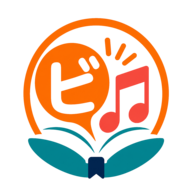
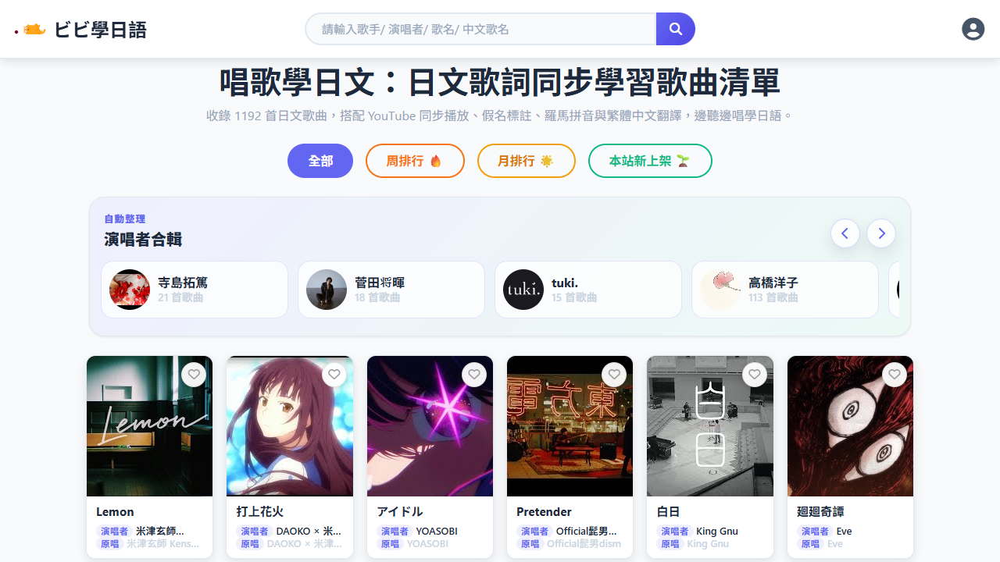

<p align="center">
  
</p>

<h1 align="center">LearnMore</h1>

<p align="center">ビビ學日語 · 日文歌曲學習</p>

<p align="center">
  <a href="https://magicplus-design.serveirc.com/LearnMore">線上使用</a> ·
  <a href="#可以怎麼練">看看功能</a> ·
  <a href="docs/PRODUCT.md">產品說明</a> ·
  <a href="docs/DEPLOYMENT.md">自行部署</a>
</p>

<p align="center">
  <a href="https://github.com/NickYCLin/learnmore/actions/workflows/ci.yml"></a>
  <a href="LICENSE"></a>
</p>

LearnMore 是以日文歌曲為素材的網頁學習工具。播放 YouTube 影片時，歌詞會跟著時間移動；你可以搭配漢字注音、羅馬拼音與繁體中文翻譯，逐句聽懂，再用跟唱和卡拉 OK 練習發音。

選一首熟悉的歌，邊聽邊看歌詞，不熟的句子就多練幾次。電腦、手機都能使用。

想直接使用，可以打開 [ビビ學日語](https://magicplus-design.serveirc.com/LearnMore)，選一首歌開始練習。瀏覽歌曲與歌詞不需要登入，收藏和管理歌曲群組則需要登入。



*首頁實際畫面。歌曲數量、排行與收錄內容會隨站台更新。*

## 可以怎麼練

<table>
  <tr>
    <td width="50%" valign="top">
      <h3>🎧 邊聽邊看同步歌詞</h3>
      <p>歌詞依 YouTube 播放時間顯示，讓你知道現在唱到哪一句，也能回到想練習的位置。</p>
    </td>
    <td width="50%" valign="top">
      <h3>あ 看懂讀音與意思</h3>
      <p>搭配漢字注音、羅馬拼音與繁體中文翻譯。遇到不熟的漢字，可以先看讀音，再跟著唱。</p>
    </td>
  </tr>
  <tr>
    <td valign="top">
      <h3>🎤 跟唱或練卡拉 OK</h3>
      <p>使用逐句練習與卡拉 OK 模式；歌曲備有人聲、伴奏音軌時，可以切換音源練習。</p>
    </td>
    <td valign="top">
      <h3>♡ 把喜歡的歌收在一起</h3>
      <p>收藏歌曲、建立歌曲群組，再用群組播放器接著練。也能從演唱者合輯找到想聽的歌。</p>
    </td>
  </tr>
  <tr>
    <td valign="top">
      <h3>📱 手機上接著練</h3>
      <p>歌曲清單、歌詞與群組管理提供行動版配置，方便在不同螢幕上搜尋、播放與整理歌曲。</p>
    </td>
    <td valign="top">
      <h3>✎ 歌詞有誤，也能修正</h3>
      <p>具有權限的使用者可以建立歌曲、編修歌詞和時間軸，並透過審核流程校正辨識結果。</p>
    </td>
  </tr>
</table>

各首歌的讀音、翻譯和音軌不一定齊全。自動辨識的歌詞與時間軸，也可以再人工修正。

## 從一首喜歡的歌開始

1. **找歌**：搜尋歌名、歌手或演唱者，或從排行與合輯挑選。
2. **聽懂**：播放影片，對照同步歌詞、讀音與中文翻譯。
3. **練熟**：反覆練習不熟的句子；有音軌的歌曲可切換人聲或伴奏。
4. **留下來**：登入後收藏歌曲，或整理成自己的練習群組。

## 想了解或修改這個專案

| 你想做什麼 | 從這裡開始 |
| --- | --- |
| 快速了解產品，或交給其他 AI 閱讀 | [產品說明與程式位置](docs/PRODUCT.md) |
| 找到功能對應的 Controller、Service 與測試 | [程式架構與閱讀入口](docs/ARCHITECTURE.md) |
| 安裝網站、保留正式設定、同步兩個儲存庫 | [部署與儲存庫同步](docs/DEPLOYMENT.md) |
| 設定遠端翻譯、辨識或音軌處理 | [LearnMoreAPI 說明](LearnMoreAPI/README.md) |
| 確認原始碼、字典與素材的授權 | [LICENSE](LICENSE) · [第三方授權說明](THIRD_PARTY_NOTICES.md) |

### 技術概覽

| 修改入口 | 程式位置 |
| --- | --- |
| 啟動、DI、Middleware、背景服務 | [`LearnMore/Program.cs`](LearnMore/Program.cs) |
| 首頁、搜尋與歌曲清單 | [`LearnMore/Controllers/HomeController.cs`](LearnMore/Controllers/HomeController.cs) |
| 同步歌詞與練習模式 | [`LearnMore/Controllers/LyricsController.cs`](LearnMore/Controllers/LyricsController.cs) |
| 上傳、編修、審核與轉錄流程 | [`LearnMore/Controllers/MediaController.cs`](LearnMore/Controllers/MediaController.cs) |
| Whisper 工作流程 | [`LearnMore/Services/WhisperTranscribeWorkflowService.cs`](LearnMore/Services/WhisperTranscribeWorkflowService.cs) |
| 日文 Ruby 產生與清理 | [`LearnMore/Services/JapaneseRubyGeneratorService.cs`](LearnMore/Services/JapaneseRubyGeneratorService.cs) |
| 音軌分離背景工作 | [`LearnMore/Services/AudioStemProcessingHostedService.cs`](LearnMore/Services/AudioStemProcessingHostedService.cs) |
| 測試案例 | [`LearnMore.Tests`](LearnMore.Tests) |

更完整的模組、資料流與修改入口整理在 [`docs/ARCHITECTURE.md`](docs/ARCHITECTURE.md)。

## iOS App（開發中）

本輪以 [`mobile/`](mobile/README.md) 的 Capacitor 客戶端為交付路線，保留 [`ios/`](ios/README.md) 的 SwiftUI 客戶端與各自的 CI。Capacitor 使用 `/api/mobile/v1/songs` 陣列契約及 8 小時登入；SwiftUI 使用 `/api/mobile/v2/songs` 分頁契約，以及獨立的 30 天 hashed session／Keychain。

SwiftUI 的帳號連結與刪除原始碼仍保留，但 API 與 store 均回應 503，避免在重新驗證、跨 session 撤銷和 SQL 並行測試尚未完成時執行破壞性操作。不能僅因電子郵件相同就自動合併登入方式；既有網站帳號的原生登入遷移仍需獨立驗證。詳見 [整合紀錄](docs/PR1_INTEGRATION.md)。簽章、真機整合、內容授權及 TestFlight 尚未驗收，目前不能送審。

## 專案結構

```text
LearnMore/
├─ Controllers/       MVC 頁面與 API 入口
├─ Services/          歌詞、轉錄、日文處理與背景工作
├─ Models/            頁面與流程資料模型
├─ Views/             Razor Views
├─ Scripts/           Whisper / WhisperX 輔助程式
└─ wwwroot/           JavaScript、CSS、圖示與前端套件
LearnMore.Tests/      xUnit 與畫面契約測試
docs/                 架構與程式碼導覽
```

### 使用技術

| 層次 | 使用技術 |
| --- | --- |
| 網站 | .NET 8、ASP.NET Core MVC、Razor、JavaScript、Bootstrap |
| 資料 | SQL Server、ADO.NET |
| 日文讀音 | MeCab、Kuroshiro、Kuromoji |
| 語音與音訊 | Whisper、faster-whisper、WhisperX、FFmpeg、yt-dlp、Demucs |
| 遠端工作 | Python、FastAPI、外部 CLI |
| 驗證 | xUnit、pytest、Playwright 腳本、GitHub Actions |

## 本機開發

需要 .NET 8 SDK、Node.js 20 以上，以及相容的 SQL Server 資料庫。音訊處理另需 FFmpeg、yt-dlp；本機辨識與分離另需 Python 及對應模型。

```powershell
# 還原日文處理套件
npm ci --prefix LearnMore/wwwroot/js

# 建立個人設定，填入資料庫與需要的服務憑證
Copy-Item LearnMore/appsettings.Local.example.json LearnMore/appsettings.Local.json

# 還原、測試，再啟動網站
dotnet restore LearnMore.sln
dotnet test LearnMore.sln --configuration Release --no-restore
dotnet run --project LearnMore/LearnMore.csproj
```

`appsettings.Local.json` 不納入 Git，也不會隨 `dotnet publish` 發布。完整站台還需要資料庫 schema、歌曲資料與外部服務；倉庫不附正式資料庫或使用者內容。部署步驟與舊設定移轉方式見 [部署說明](docs/DEPLOYMENT.md)。

### 儲存庫內容

```text
LearnMore/           網站、歌曲播放、歌詞、管理頁面與背景服務
LearnMore.Tests/     網站單元測試與畫面契約測試
LearnMoreAPI/        遠端翻譯、辨識、音軌服務與 API 測試
scripts/             資料整理與部署驗證工具
docs/                產品說明、架構、部署說明與截圖
```

GitLab 與 GitHub 的 `main` 維持相同檔案內容，各自保留提交歷史。環境設定、資料庫與媒體檔由部署環境管理。

## 授權與內容來源

自行撰寫的原始碼與文件採 [MIT License](LICENSE)。第三方函式庫、日文字典、角色素材，以及歌曲、歌詞、翻譯、封面與影音內容依各自授權或權利範圍使用，詳見 [第三方授權說明](THIRD_PARTY_NOTICES.md)。
